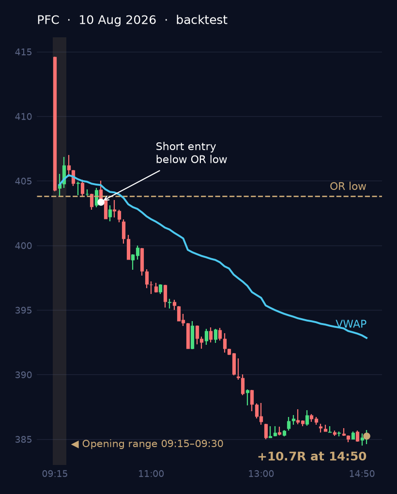
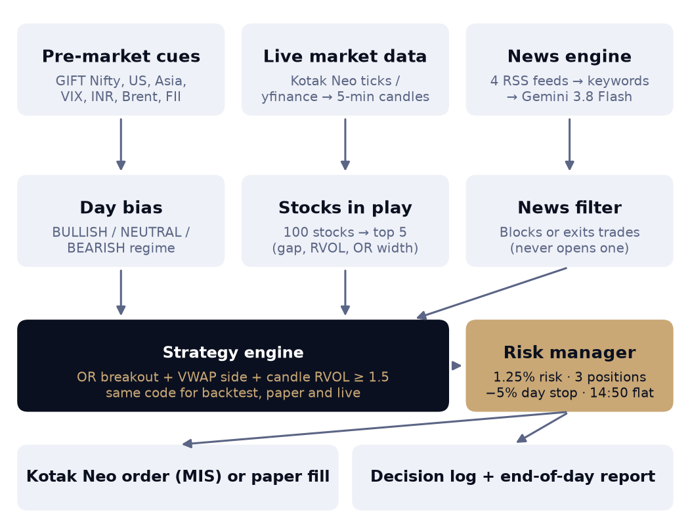
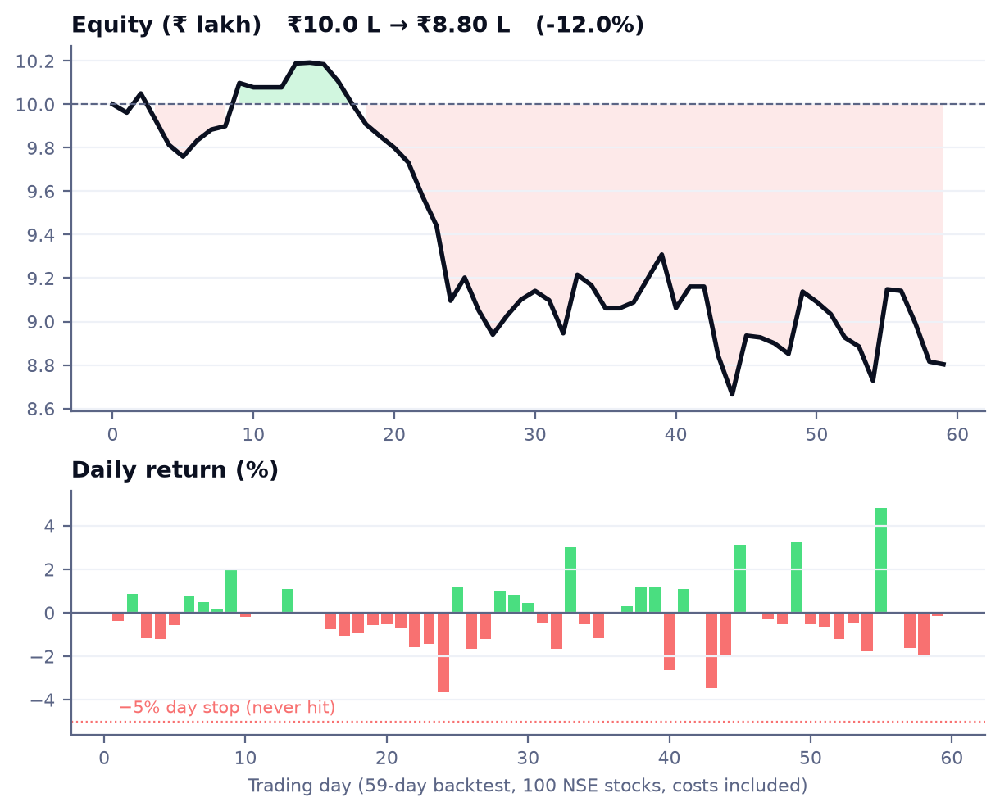

# Sentinel ORB — Team Blaze

Intraday trading bot for NSE (India), built for the TechVerse 2026 Trading arena.

**Sentinel ORB** = stocks-in-play **O**pening-**R**ange **B**reakout with VWAP trend, a market-sentiment
bias and a live news guard. Every rule is fixed and every decision is logged with its reason.



## What it does

1. **08:30–09:15 — read the market.** Scores pre-market cues (GIFT Nifty, US futures, Asia, India VIX,
   USD/INR, Brent, FII flows) into a day bias: BULLISH, NEUTRAL or BEARISH.
2. **09:30 — pick stocks in play.** Ranks ~100 liquid NSE stocks by gap, relative volume, opening-range
   width and news, and watches the top 5.
3. **09:30–14:15 — trade the breakout.** Goes long above the 09:15–09:30 range high (short below the low)
   only when price is on the right side of VWAP, candle volume is ≥ 1.5× normal and the move is not
   over-extended.
4. **Manage risk.** 1.25% of equity risked per trade, max 3 positions and 8 trades a day, stop to
   breakeven at +1R, half booked at +2R, the rest trails. A −5% day loss flattens everything.
   All positions are closed at 14:50.
5. **News guard.** RSS headlines are scored by a keyword lexicon and Gemini 3.8 Flash. Bad news blocks or
   exits a trade; news never opens one by itself.



## Backtest (59 days, 100 stocks, ₹10 L, costs included)



| Metric | Result |
|---|---|
| Return | −12.0% (₹10.0 L → ₹8.80 L) |
| Max drawdown | −15.0% |
| Trades | 224 (3.8 a day), 39.7% winners |
| Profit factor | 0.78 |
| Worst day | −3.7% (the −5% day stop was never hit) |
| Long vs short | Shorts +₹7.3 k, longs −₹1.27 L |

News is not replayed in the backtest; the pre-market bias uses a historical proxy. Next work: tighten the
long side and cut trade count to lower costs.

## How to run

```bash
python3 -m venv .venv && source .venv/bin/activate
pip install -r requirements.txt
cp .env.example .env            # paper mode needs no keys

pytest                           # unit tests, no network
python run_backtest.py --days 59 # writes reports/backtest/
python run_live.py --mode paper  # live data, simulated fills
python run_live.py --mode live   # real orders on Kotak Neo (asks you to type CONFIRM)
```

`python run_live.py --dry-run` checks the config and prints the day's schedule without trading.
Create a file named `STOP` in the project folder to flatten everything and exit.

All parameters live in [`config.yaml`](config.yaml); the full rule set is in [`SPEC.md`](SPEC.md).

## Tools and versions

- Python 3.14, pandas, NumPy, matplotlib, pytest
- Kotak Neo Trade API (`neo_api_client`) for orders and live ticks; yfinance for history and paper feed
- google-genai with Gemini 3.8 Flash for headline scoring
- feedparser, requests, pyotp, PyYAML, python-dotenv

## Project layout

```
algo/        strategy, risk, selection, indicators, portfolio, engine
algo/broker/ Kotak Neo and paper brokers
algo/sentiment/ pre-market score, news fetch, keyword and Gemini scorers
backtest/    data download, replay, metrics, plots
tests/       pytest suite
```

## Team

**Team Blaze** — Achal Joshi (solo): strategy, code, backtest and live trading.
